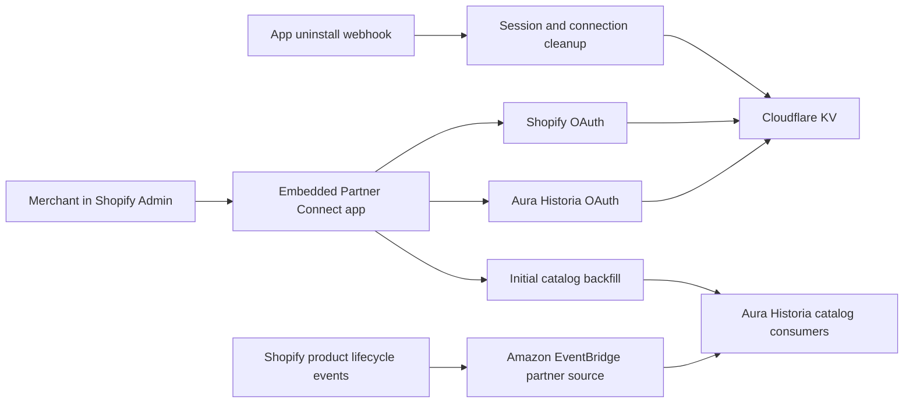

<h1 align="center">Aura Historia Partner Connect</h1>

<p align="center">
  A quiet, reliable bridge between Shopify product catalogs and the Aura Historia sales channel.
</p>

<p align="center">
  <a href="https://github.com/aura-historia/shopify-app/actions/workflows/ci.yml"></a>
  <a href="./LICENSE"></a>
  <a href="./package.json"></a>
  <a href="https://shopify.dev/docs/api/usage/versioning"></a>
</p>

<p align="center">
  <a href="#architecture">Architecture</a>&nbsp;&nbsp;·&nbsp;&nbsp;
  <a href="#local-development">Local development</a>&nbsp;&nbsp;·&nbsp;&nbsp;
  <a href="#quality-checks">Quality checks</a>&nbsp;&nbsp;·&nbsp;&nbsp;
  <a href="#deployment">Deployment</a>
</p>

---

## In brief

**Aura Historia Partner Connect** is a public, embedded Shopify sales-channel app. It lets approved merchants connect their shops to Aura Historia, makes product discovery possible on Aura Historia, and returns shoppers to the merchant’s Shopify store for checkout.

The app intentionally owns only the integration edge: authentication, merchant connection, initial catalog backfill, session storage, advertised shipping imports, and uninstall cleanup. Amazon EventBridge routing and downstream catalog consumers are maintained separately.

| Shopify | Aura Historia |
| --- | --- |
| Merchant installs from Shopify App Store or Admin | Merchant authorizes Aura Historia from the embedded app |
| Shopify supplies trusted shop context and OAuth approval | Connection metadata is stored in Cloudflare KV |
| Product events are delivered to the configured EventBridge partner source | Catalog records are published for discovery |
| Shopper continues to the merchant’s Shopify storefront | No checkout or merchant-of-record responsibility moves to Aura Historia |

## Architecture



### What lives here

- React Router application and embedded Shopify app shell
- Shopify authentication, Aura Historia OAuth, and connection state
- Cloudflare Worker deployment and Cloudflare KV session storage
- Initial product backfill orchestration
- Server-side shipping acquisition, typed mapping and resumable publication
- A per-shop Durable Object coordinating offline Shopify access and shipping jobs
- Shopify sales-channel configuration in `extensions/channel-config`
- Uninstall cleanup at `app/routes/webhooks.app.uninstalled.tsx`

### What does not

- EventBridge infrastructure, rules, or consumers
- A checkout experience or storefront
- Demo pages, sample mutations, or placeholder app logic

## Event delivery

| Topic | Destination | Purpose |
| --- | --- | --- |
| `products/create`, `products/update`, `products/delete` | Aura Historia Amazon EventBridge partner source | Keep merchant product discovery records current |
| `customers/data_request`, `customers/redact`, `shop/redact` | Aura Historia Amazon EventBridge partner source | Required public-app privacy and compliance handling |
| `app/uninstalled` | This app’s deployed HTTPS endpoint | Remove Shopify session and Aura Historia connection data |
| `bulk_operations/finish` | This app’s deployed HTTPS endpoint | Complete the initial catalog backfill workflow |

The required public-app compliance subscriptions and product subscriptions are declared in `shopify.app.toml` and `shopify.app.prod.toml`.

## Local development

### Requirements

- [Node.js](https://nodejs.org/) **22.18 or later**
- A Shopify Partner account and app credentials
- A Cloudflare KV namespace for session storage
- Aura Historia OAuth client credentials

### Start the app

```bash
npm ci
npm run dev
```

The default command runs `shopify app dev --use-localhost`.

Create local runtime configuration for the Aura Historia OAuth client. The app requires:

```bash
# PLACEHOLDER: replace with the canonical oc_... ID registered in the stage backend.
AURA_HISTORIA_OAUTH_CLIENT_ID=oc_REPLACE_WITH_STAGE_OAUTH_CLIENT_ID
AURA_HISTORIA_OAUTH_CLIENT_SECRET=
AURA_HISTORIA_OAUTH_ENV=dev
```

These values override the built-in environment defaults when needed. The committed production `wrangler.jsonc` also contains an intentionally invalid placeholder client ID: replace it with the registered production `oc_...` ID before deployment. The stage and production OAuth clients must each allow `listing-sources:read listing-sources:write product-listings:read product-listings:write` and their respective Shopify callback redirect URI. OAuth refuses to start with either placeholder. The backend development API base URL is `https://api.stage.aura-historia.com` (production: `https://api.aura-historia.com`). For the Shopify connection, request the Aura Historia OAuth scopes `listing-sources:read listing-sources:write product-listings:read product-listings:write` (separate from the Shopify access scopes below). Set `AURA_HISTORIA_API_BASE_URL` and `AURA_HISTORIA_OAUTH_SCOPE` to match the target backend and registered OAuth client:

```bash
AURA_HISTORIA_API_BASE_URL=https://api.stage.aura-historia.com
AURA_HISTORIA_OAUTH_AUTHORIZE_URL=
AURA_HISTORIA_OAUTH_TOKEN_URL=
AURA_HISTORIA_OAUTH_REDIRECT_URI=
AURA_HISTORIA_OAUTH_SCOPE=listing-sources:read listing-sources:write product-listings:read product-listings:write
```

> **Webhook testing:** Shopify localhost mode cannot call your machine directly. Product and compliance events continue to use EventBridge, while `app/uninstalled` remains pinned to the deployed HTTPS app URL. For direct local testing of the backfill completion webhook, use tunnel mode:
>
> ```bash
> npm run dev:tunnel
> ```

## Shopify configuration

The repository uses separate Shopify configuration files to keep stage-specific EventBridge destinations explicit:

| File | Use |
| --- | --- |
| `shopify.app.toml` | Default local/stage configuration using the development EventBridge partner source |
| `shopify.app.prod.toml` | Production configuration using the production EventBridge partner source |
| `shopify.app.tunnel.toml` | Development tunnel mode; exposes the backfill completion endpoint through the active tunnel |

The required Shopify scopes are `read_products` and `read_locales`; `read_shipping` is optional and requested from the embedded app for advertised shipping imports. Installation starts from Shopify-owned surfaces, which supply the trusted `shop` and `host` context—merchants are not asked to manually enter a shop domain.

## Advertised shipping imports

Initial Aura connection queues a shipping import independently of the catalog backfill.
The embedded app offers **Grant shipping access** (renewed optional consent) and
**Import shipping settings** (new acquisition or resume). Existing Aura connections
need reconnection with the additional `listing-sources:read` and `product-listings:read`
OAuth permissions. Register those permissions on both OAuth clients before rollout.

Shipping runs in app-owned Durable Object alarms without an open browser. The
`SHOP_COORDINATOR` binding and `shop-coordinator-v1` SQLite migration are required.
Catalog and shipping use its serialized offline GraphQL path, which delegates token
refresh to the existing Shopify SDK and KV sessions. The backend never calls this
worker, reads its sessions, or receives Shopify credentials.

`app/shipping/acquisition.server.ts`, `mapper.ts`, and `publisher.server.ts` are the
common S01/S02 implementation. Future profile notifications should call the same
`requestShipping(shop)` RPC through the authenticated app; they must not publish
their own snapshots. Work is ordered by the current shop/source binding and an
increasing durable sequence. Concurrent requests coalesce into a subsequent read.
Conflicts trigger bounded reacquisition; pending uncertain writes retain their body,
request key, sequence and original acquisition time across worker restarts. Missing
catalog listings are retried independently without creating products. Partner-owned
assertions and explicit clears are protected by backend import ownership checks.

Reads are bounded to 50 records per connection page, 100 profiles, 5,000 products,
4,000 requests and 4 MB of acquisition state. Every page has a persisted checkpoint.
The importer traverses all profile items, assigned variants, product variants, zones
and methods. A final profile/version traversal and product modification checks detect
observed changes and restart affected acquisition; this is not an atomic Shopify
snapshot. Failed/incomplete traversals never retire unseen objects. Only a complete
read can explicitly retire previously mapped, confirmed missing profiles.

The pinned Admin API is **2026-10**. Its published `DeliveryMethodDefinition` schema
exposes `rateProvider` and `methodConditions`. The [shipping option changelog](https://shopify.dev/changelog/posts/new-apis-to-read-and-write-shipping-options-in-delivery-profile)
documents the legacy read expansion of every tier and free condition into separate
methods; all method pages are consumed. A preflight checks the required schema and
granted scope. `read_assigned_shipping` cannot read the complete shop profile/item
membership, so it is insufficient. No shipping write, order, customer or checkout
scope is requested. Any Shopify approval required for `read_shipping` must be
completed in the Partner Dashboard before enabling consent; denial is reported in
shipping status and does not fail catalog sync. S02 profile webhook subscriptions
belong to this app and use the same shipping read permission.

The supported subset is a profile with one origin group, no unrated origins or
selling-plan applicability, explicit country zones, static rates, minimum
seller-order value conditions and external carrier/app prices. Money is parsed as
decimal strings into exact safe minor units; unsupported currencies/precision stop
publication. All variants must agree before a listing selects one profile. Mixed,
incomplete and unsupported membership explicitly suppresses default inheritance.
Profiles with multiple origin groups or selling plans remain unasserted. Province
subsets/rest-of-world zones remain unresolved; weight and upper basket constraints
have no Aura representation and leave the affected service conditional without a
fixed rate. Shopify's cart/profile/location charge groups have no exact Aura charge
basis, so static amounts retain a null basis and a capability notice instead of
claiming a per-item, order or physical-shipment price. Coverage stays partial, and
external prices stay externally calculated.
`ShopFeatures.marketDrivenShipping` is detected and reported as a capability gap;
the legacy profiles do not describe that model. None of these limitations is filled
with inferred locations, eligibility, taxes, packing, duties or checkout prices.

Status distinguishes queued work, acquisition, publication, partial progress,
protected partner edits and applied operations. Applied means Aura committed the
typed write; discovery indexing remains eventual and no shipping quote is promised.
Use the manual import action to reconcile after resolving permissions, capabilities
or a bounded failure. S02 ongoing notifications and recovery are tracked separately.

The official generated Aura client is pinned in `openapi-ts.config.ts` to backend
commit `8f39fcd549ebc49608bb2722bb219e623c6742e2` (B05, PR #2146).
Run `npm run openapi:generate` to reproduce it; review later contract changes
explicitly. `tests/fixtures/shipping-contract.json` is the executable contract
fixture from the same commit. Ordinary typed shipping writes carry `import` metadata
with `observation: {}` for successful acquisitions, and no expiry/freshness fields.
Returned assertion evidence uses `verifiedAt`.

### External services and privacy

With merchant consent, Shopify provides shipping profile names/IDs, location-group
identities, destination areas, advertised methods/conditions/prices and complete
product/variant membership. Cloudflare stores bounded private job checkpoints,
resource mappings and immutable pending typed requests. Aura Historia receives only
the canonical terms, source-scoped membership and acquisition metadata through its
authorized API. Shipping requests contain no provider domain, token, session, raw
provider payload, customer data or precise fulfillment address. The separate catalog
ingestion domain configuration remains necessary for existing EventBridge ingestion.
Errors exposed by shipping status contain categories, never provider response bodies
or credentials. Disconnect cancels jobs; uninstall erases shipping state and sessions.
The linked Aura privacy policy and App Store access disclosure must reflect this
optional processing when the feature is released.

## Quality checks

Run the full suite before opening a pull request:

```bash
npm run lint
npm run typecheck
npm run test
npm run build
```

| Command | Responsibility |
| --- | --- |
| `npm run lint` | Biome formatting and lint checks |
| `npm run typecheck` | React Router type generation and TypeScript validation |
| `npm run test` | Focused Node test suite |
| `npm run build` | Production React Router build |

GitHub Actions runs these checks across Node.js 22.18, 24.15, and 26.1 on pushes and pull requests. See [`.github/workflows/ci.yml`](./.github/workflows/ci.yml).

## Deployment

- `npm run lint`
- `npm run typecheck`
- `npm run test`
- `npm run build`

```bash
npm run cf-deploy       # Build and deploy the Cloudflare Worker
npm run config:use:prod # Select Shopify production configuration locally
npm run deploy:prod     # Deploy Shopify app configuration to production
```

The GitHub Actions workflow requires these repository secrets:

- `CLOUDFLARE_API_TOKEN`
- `CLOUDFLARE_ACCOUNT_ID`
- `SHOPIFY_APP_AUTOMATION_TOKEN`

See [`.github/workflows/deploy.yml`](./.github/workflows/deploy.yml) for the release definition.

## Public app information

- Website: [aura-historia.com](https://aura-historia.com)
- Privacy: [aura-historia.com/privacy](https://aura-historia.com/privacy)
- Terms: [aura-historia.com/terms-and-conditions](https://aura-historia.com/terms-and-conditions)
- Imprint: [aura-historia.com/imprint](https://aura-historia.com/imprint)
- Support: [contact@aura-historia.com](mailto:contact@aura-historia.com)

## License

Distributed under the [MIT License](./LICENSE). Copyright © 2026 Aura Historia.

---

<p align="center">
  
</p>
