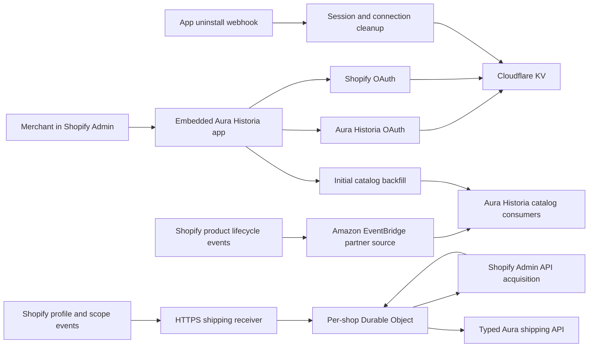

<h1 align="center">Aura Historia for Shopify</h1>

<p align="center">
  A quiet, reliable bridge between Shopify product catalogs and the Aura Historia sales channel.
</p>

<p align="center">
  <a href="https://github.com/aura-historia/shopify-app/actions/workflows/ci.yml"></a>
  <a href="./LICENSE"></a>
  <a href="./package.json"></a>
  <a href="https://shopify.dev/docs/api/usage/versioning"></a>
</p>

<p align="center">
  <a href="#architecture">Architecture</a>&nbsp;&nbsp;·&nbsp;&nbsp;
  <a href="#local-development">Local development</a>&nbsp;&nbsp;·&nbsp;&nbsp;
  <a href="#quality-checks">Quality checks</a>&nbsp;&nbsp;·&nbsp;&nbsp;
  <a href="#deployment">Deployment</a>
</p>

---

## In brief

The **Aura Historia** app is a public, embedded Shopify sales-channel app. It lets approved merchants connect their shops to Aura Historia, makes product discovery possible on Aura Historia, and returns shoppers to the merchant’s Shopify store for checkout.

The app intentionally owns only the integration edge: authentication, merchant connection, initial catalog backfill, session storage, advertised shipping imports, and uninstall cleanup. Amazon EventBridge routing and downstream catalog consumers are maintained separately.

| Shopify | Aura Historia |
| --- | --- |
| Merchant installs from Shopify App Store or Admin | Merchant authorizes Aura Historia from the embedded app |
| Shopify supplies trusted shop context and OAuth approval | Connection metadata is stored in Cloudflare KV |
| Product events are delivered to the configured EventBridge partner source | Catalog records are published for discovery |
| Shopper continues to the merchant’s Shopify storefront | No checkout or merchant-of-record responsibility moves to Aura Historia |

## Architecture



### What lives here

- React Router application and embedded Shopify app shell
- Shopify authentication, Aura Historia OAuth, and connection state
- Cloudflare Worker deployment and Cloudflare KV session storage
- Initial product backfill orchestration
- Server-side shipping acquisition, typed mapping and resumable publication
- A per-shop Durable Object coordinating offline Shopify access and shipping jobs
- Shopify sales-channel configuration in `extensions/channel-config`
- Uninstall cleanup at `app/routes/webhooks.app.uninstalled.tsx`

### What does not

- EventBridge infrastructure, rules, or consumers
- A checkout experience or storefront
- Demo pages, sample mutations, or placeholder app logic

## Event delivery

| Topic | Destination | Purpose |
| --- | --- | --- |
| `products/create`, `products/update`, `products/delete` | Aura Historia Amazon EventBridge partner source | Keep merchant product discovery records current |
| `customers/data_request`, `customers/redact`, `shop/redact` | Aura Historia Amazon EventBridge partner source | Required public-app privacy and compliance handling |
| `profiles/create`, `profiles/update`, `profiles/delete` | This app’s HTTPS `/webhooks/shipping` receiver | Durably schedule current shipping acquisition |
| `app/scopes_update` | This app’s HTTPS `/webhooks/shipping` receiver | Recheck current shipping access, import once updated access is approved, and withdraw owned assertions on permission loss |
| `app/uninstalled` | This app’s deployed HTTPS endpoint | Stop shipping, admit owned cleanup, then remove Shopify sessions and connection data |
| `bulk_operations/finish` | This app’s deployed HTTPS endpoint | Complete the initial catalog backfill workflow |

The required public-app compliance subscriptions and product subscriptions are declared in `shopify.app.toml` and `shopify.app.prod.toml`.

## Local development

### Requirements

- [Node.js](https://nodejs.org/) **22.18 or later**
- A Shopify Partner account and app credentials
- A Cloudflare KV namespace for session storage
- Aura Historia OAuth client ID and secret (confidential client)

### Start the app

```bash
npm ci
npm run dev
```

The default command runs `shopify app dev --use-localhost`.

Create local runtime configuration for the Aura Historia OAuth client. The app requires:

```bash
# PLACEHOLDER: replace with the canonical oc_... ID registered in the stage backend.
AURA_HISTORIA_OAUTH_CLIENT_ID=oc_REPLACE_WITH_STAGE_OAUTH_CLIENT_ID
AURA_HISTORIA_OAUTH_CLIENT_SECRET=
AURA_HISTORIA_OAUTH_ENV=dev
```

Use `.dev.vars` for local Cloudflare binding overrides; shell variables do not override bindings in `wrangler.jsonc`. Production uses the registered client `oc_01m5vyyghjecx8c43drb05hh4n`; its secret is stored as `AURA_HISTORIA_OAUTH_CLIENT_SECRET` in Cloudflare, never in source. Both the client ID and secret are required (`client_secret_post` plus S256 PKCE). The stage and production OAuth clients must each allow `listing-sources:read listing-sources:write product-listings:read product-listings:write` and their respective Shopify callback redirect URI. OAuth refuses to start with a placeholder ID or missing secret. The backend development API base URL is `https://api.stage.aura-historia.com` (production: `https://api.aura-historia.com`). For the Shopify connection, request the Aura Historia OAuth scopes `listing-sources:read listing-sources:write product-listings:read product-listings:write` (separate from the Shopify access scopes below). Set `AURA_HISTORIA_API_BASE_URL` and `AURA_HISTORIA_OAUTH_SCOPE` to match the target backend and registered OAuth client:

```bash
AURA_HISTORIA_API_BASE_URL=https://api.stage.aura-historia.com
AURA_HISTORIA_OAUTH_AUTHORIZE_URL=
AURA_HISTORIA_OAUTH_TOKEN_URL=
AURA_HISTORIA_OAUTH_REDIRECT_URI=
AURA_HISTORIA_OAUTH_SCOPE=listing-sources:read listing-sources:write product-listings:read product-listings:write
```

> **Webhook testing:** Shopify localhost mode cannot call your machine directly. Product and compliance events continue to use EventBridge, while `app/uninstalled` remains pinned to the deployed HTTPS app URL. For direct local testing of the backfill completion webhook, use tunnel mode:
>
> ```bash
> npm run dev:tunnel
> ```

## Shopify configuration

The repository uses separate Shopify configuration files to keep stage-specific EventBridge destinations explicit:

| File | Use |
| --- | --- |
| `shopify.app.toml` | Default local/stage configuration using the development EventBridge partner source |
| `shopify.app.prod.toml` | Production configuration using the production EventBridge partner source |
| `shopify.app.tunnel.toml` | Development tunnel mode; exposes backfill completion and shipping receivers through the active tunnel |

The required Shopify scopes are `read_products`, `read_locales` and `read_shipping`. `read_shipping` must stay required: the profile webhook subscriptions are declared statically, and Shopify rejects static subscriptions whose scope is only optional. The same list is mirrored in the `SCOPES` variable of `wrangler.jsonc`. Installation starts from Shopify-owned surfaces, which supply the trusted `shop` and `host` context—merchants are not asked to manually enter a shop domain.

## Advertised shipping imports

Initial Aura connection queues a shipping import independently of the catalog backfill.
The embedded app offers **Import shipping settings** (new acquisition or resume).
Installations approved before `read_shipping` became required are asked by Shopify
to approve the updated access the next time the app is opened. Until then shipping
status reports the missing permission and catalog sync continues; the resulting
`app/scopes_update` notification starts a new acquisition. Existing Aura connections
need reconnection with the additional `listing-sources:read` and `product-listings:read`
OAuth permissions. Register those permissions on both OAuth clients before rollout.

Shipping runs in app-owned Durable Object alarms without an open browser. The
`SHOP_COORDINATOR` binding and `shop-coordinator-v1` SQLite migration are required.
Catalog and shipping use its serialized offline GraphQL path, which delegates token
refresh to the existing Shopify SDK and KV sessions. The backend never calls this
worker, reads its sessions, or receives Shopify credentials.

`app/shipping/acquisition.server.ts`, `mapper.ts`, and `publisher.server.ts` are the
common S01/S02 implementation. Initial connection, **Import shipping settings**,
profile notifications and periodic reconciliation all use that acquisition/mapper/publisher.
Callbacks authenticate the bounded original body with Shopify, require an existing
offline installation and durable source binding, then commit a deduplicated hint
inbox. No provider read, token refresh or Aura publication runs in the callback.
The receiver returns 503 on failed durable admission, so Shopify retries.
Hints carry metadata only and never supply the Aura source identity or policy. Work is ordered by the current shop/source binding and an
increasing durable sequence. Concurrent requests coalesce into a subsequent read.
Conflicts trigger bounded reacquisition; pending uncertain writes retain their body,
request key, sequence and original acquisition time across worker restarts. Missing
catalog listings are retried independently without creating products. Partner-owned
assertions and explicit clears are protected by backend import ownership checks.
Reconciliation resolves other uncertain requests before replacing an acquisition.
An inbox hint received during a scan forces reacquisition before publication.
Already prepared requests resolve with their original keys, sequence and acquiredAt
before newer work; no old observation is rebased onto a current revision.
Publication stops retrying each record after eight failures; acquisition pauses after
eight consecutive failures on a page. Exhausted work remains saved for up to seven days,
subject to replacement by a new complete acquisition during periodic repair. **Import shipping settings**
resumes those exact pending requests before acquiring the latest settings. GraphQL
and Aura API calls have a 20-second timeout, and applied status requires a valid
committed response.

Reads are bounded to 50 records per connection page, 100 profiles, 5,000 products,
4,000 requests and 4 MB of acquisition state. Every page has a persisted checkpoint.
The importer traverses all profile items, assigned variants, product variants, zones
and methods. A final profile/version traversal and product modification checks detect
observed changes and restart affected acquisition; this is not an atomic Shopify
snapshot. Failed/incomplete traversals never retire unseen objects. Only a complete
read can explicitly retire previously mapped, confirmed missing profiles. Complete product comparisons also explicitly remove
previously owned selections/inputs for products that disappeared from Shopify.

The pinned Admin API is **2026-10**. Its published `DeliveryMethodDefinition` schema
exposes `rateProvider` and `methodConditions`. The [shipping option changelog](https://shopify.dev/changelog/posts/new-apis-to-read-and-write-shipping-options-in-delivery-profile)
documents the legacy read expansion of every tier and free condition into separate
methods; all method pages are consumed. A preflight checks the required schema and
granted scope. `read_assigned_shipping` cannot read the complete shop profile/item
membership, so it is insufficient. No shipping write, order, customer or checkout
scope is requested. Any Shopify approval required for `read_shipping` must be
completed in the Partner Dashboard before release; missing access is reported in
shipping status and does not fail catalog sync. Profile webhook subscriptions
belong to this app and use the same shipping read permission. The pinned
[2026-10 WebhookSubscriptionTopic reference](https://shopify.dev/docs/api/admin-graphql/2026-10/enums/WebhookSubscriptionTopic)
lists all three PROFILES topics with `read_shipping` or `read_assigned_shipping`;
full acquisition requires `read_shipping`. No extra scope is needed for
`app/scopes_update`. The pinned webhook examples and backend commit are recorded
in `tests/fixtures/shopify-shipping-webhooks-2026-10.json`.

The supported subset is a profile with one origin group, no unrated origins or
selling-plan applicability, explicit country zones, static rates, minimum
seller-order value conditions and external carrier/app prices. Money is parsed as
decimal strings into exact safe minor units; unsupported currencies/precision stop
publication. All variants must agree before a listing selects one profile. Shopify's
shop-wide profile applies only to variants explicitly marked as requiring shipping;
this flag alone does not establish profile membership or shipping eligibility. Mixed,
incomplete and unsupported membership explicitly suppresses default inheritance.
Profiles with multiple origin groups or selling plans remain unasserted. Province
subsets/rest-of-world zones remain unresolved; weight and upper basket constraints
have no Aura representation and leave the affected service conditional without a
fixed rate. Shopify's cart/profile/location charge groups have no exact Aura charge
basis, so static amounts retain a null basis and a capability notice instead of
claiming a per-item, order or physical-shipment price. Coverage stays partial, and
external prices stay externally calculated.
`ShopFeatures.marketDrivenShipping` is detected and reported as a capability gap;
the legacy profiles do not describe that model. None of these limitations is filled
with inferred locations, eligibility, taxes, packing, duties or checkout prices.

Status distinguishes queued work, acquisition, publication, partial progress,
protected partner edits and applied operations. Applied means Aura committed the
typed write; discovery indexing remains eventual and no shipping quote is promised.
Use the authenticated **Import shipping settings** action to repair after resolving
permissions, capabilities or a bounded failure. **Refresh shipping status** distinguishes
committed operations from pending work; search indexing remains eventual.

The official generated Aura client is pinned in `openapi-ts.config.ts` to backend
commit `597425dcca064e7128072b988042ab3f9b1aedd1` (the production `/v1` contract).
Run `npm run openapi:generate` to reproduce it; review later contract changes
explicitly. Backend URLs use `/v1`, including `/v1/oauth/token` and `/v1/oauth/revoke`; the former `/api/v1` routes have no compatibility aliases. Browser consent starts at `/en/oauth/authorize`. Catalog and shipping imports share the current currency registry, including ARS and zero-decimal JPY/KRW. `tests/fixtures/shipping-contract.json` is the executable contract
fixture from that contract (its command examples remain unchanged). Ordinary typed shipping writes carry `import` metadata
with `observation: {}` for successful acquisitions, and no expiry/freshness fields.
Protected shipping evidence is excluded from management responses. The strict import/write contract remains separate from the public shipping read projection.

### Continuous refresh and recovery

`app/routes/webhooks.shipping.tsx` is the app-owned receiver. Stage/default and
production declare absolute `https://partner-connect.aura-historia.com/webhooks/shipping`
destinations; localhost development therefore uses the deployed receiver. Tunnel
configuration declares `/webhooks/shipping`, resolved to the active HTTPS tunnel.
The product/compliance EventBridge destinations and uninstall/bulk endpoints retain
their existing destinations. No additional product notification or catalog mutation
is submitted by shipping. A Worker deployment does not activate a new Shopify configuration version. Shopify configuration is released separately with a semver tag; live merchant exports are initiated only by the authorized installation.

The per-shop Durable Object has a transactional hint inbox independent of provider
I/O. It retains up to 512 delivery receipts per source/connection for 48 hours,
returning retryable backpressure at capacity. Delivery IDs deduplicate within that
binding; a reconnect creates a new random connection generation. Callback bodies
are limited to 16 KiB. Topics, API version and profile GIDs are validated. A delete
is a refresh hint: a complete API traversal and final verification must confirm
absence before retiring a previously owned profile. Scope errors, missing pages
and failed reads preserve prior terms and observation age. Scope-change notifications
fence old prepared writes before the next current-access check.

Every bound shop schedules a new reconciliation six hours after successful work.
Paused work gets a bounded new acquisition at that interval; each run retains the
S01 limits (100 profiles, 5,000 products, 4,000 pages, 4 MB). This covers profile
assignment changes, product/variant membership and requires-shipping changes,
origin-group/configuration changes and missed notifications independently of catalog
EventBridge processing. It does not assume that profiles/update observes every
assignment change. Unsupported origin or market-driven configurations remain
unasserted and actionable. This is acquisition of current state, never TTL renewal
or a scan of backend CDC/SQS pending work. Existing installations enter this schedule
on their next initial/manual import; there is no unbounded installation enumeration.

Worker alarms checkpoint one provider request or typed prepare/send step at a time.
Eight attempts per record/page and exponential delays bound automatic retries.
Missing catalog listings remain deferred with SHIPPING_IMPORT_DEPENDENCY_MISSING;
manual repair resumes exact pending requests, and the seven-day retention cap
bounds old request bodies. A new complete acquisition may supersede exhausted
work, using stable object identities and a new acquisition order. The callback
inbox does not wait for provider reads and cannot overwrite a connection stop.

Permission loss withdraws owned shipping profiles, defaults, listing selections
and inputs through the existing typed commands. Selection and input removals are
independent; manual edits/clears and collection/shipping overrides stay protected
by backend ownership checks. Product synchronization credentials remain usable.
Uninstall/disconnect queues the same removals, then attempts Aura OAuth token
revocation. OAuth revocation is recorded separately; it is not reported as source
or grant revocation. Source switching fences old work and queues cleanup before
new acquisition; at most five connection cleanups can be retained. Removals retain
the last successful source acquisition time, so a newer backend authority boundary
is never bypassed with a new timestamp. Reconnect always reads Shopify again.

Cleanup status distinguishes **pending**, **committed** owned removals, and
**unconfirmed** cleanup. Configuration/authority conflicts, unavailable credentials
or exhausted retries can leave cleanup unconfirmed; it is visible in the embedded
app where the installation is still accessible. Reconnect and import current
settings, or have an authorized source administrator remove the remaining imports
and review source/grant configuration. Stopping locally, erasing sessions or revoking
an OAuth token does not prove that backend assertions were removed. Unconfirmed
assertions can remain available beyond 30 days until explicitly updated/withdrawn
or a backend source/configuration/grant authority change commits. They never expire
because of observation age. Discovery indexing follows existing backend CDC/SQS
continuations and retry/DLQ controls.

### External services and privacy

With the merchant's installation approval, Shopify provides shipping profile
names/IDs, location-group identities, destination areas, advertised
methods/conditions/prices and complete
product/variant membership. Cloudflare stores bounded private job checkpoints,
resource mappings and immutable pending typed requests. Aura Historia receives only
the canonical terms, source-scoped membership and acquisition metadata through its
authorized API. Shipping requests contain no provider domain, token, session, raw
provider payload, customer data or precise fulfillment address. The separate catalog
ingestion domain configuration remains necessary for existing EventBridge ingestion.
Errors exposed by shipping status contain categories, never provider response bodies
or credentials. Disconnect durably fences publication before admitting cleanup; uninstall also
erases Shopify sessions and the ordinary Aura connection immediately. Only required
Aura credentials for cleanup remain in a separate protected KV entry, with a
seven-day maximum retention. No Shopify token is copied. Cleanup state retains only
canonical typed removal requests and resource identities, then discards them.
Minimal stop/status tombstones are erased after seven days; unknown installations
and hints cannot recreate a binding.
The linked Aura privacy policy and App Store access disclosure must reflect this
processing when the feature is released.

## Quality checks

Run the full suite before opening a pull request:

```bash
npm run lint
npm run typecheck
npm run test
npm run build
```

| Command | Responsibility |
| --- | --- |
| `npm run lint` | Biome formatting and lint checks |
| `npm run typecheck` | React Router type generation and TypeScript validation |
| `npm run test` | Focused Node test suite |
| `npm run build` | Production React Router build |

GitHub Actions runs these checks across Node.js 22.18, 24.15, and 26.1 on pushes and pull requests. See [`.github/workflows/ci.yml`](./.github/workflows/ci.yml).

## Deployment

- `npm run lint`
- `npm run typecheck`
- `npm run test`
- `npm run build`

```bash
npm run cf-deploy       # Build and deploy the Cloudflare Worker
npm run config:use:prod # Select Shopify production configuration locally
npm run deploy:prod     # Deploy Shopify app configuration to production
```

The GitHub Actions workflow requires these repository secrets:

- `CLOUDFLARE_API_TOKEN`
- `CLOUDFLARE_ACCOUNT_ID`
- `SHOPIFY_APP_AUTOMATION_TOKEN`

See [`.github/workflows/deploy.yml`](./.github/workflows/deploy.yml) for the release definition. A manual workflow dispatch runs the same checks and deploys only the Worker. A semver tag also releases the production Shopify app configuration. Production URL rewriting by Shopify development commands is disabled.

The Worker keeps OAuth/authenticated responses private and uncached, uses `Referrer-Policy: no-referrer`, and redacts query strings from Cloudflare invocation logs. Catalog progress stores only phase/counts for seven days and is cleared on disconnect/uninstall; access tokens remain only in the separate existing credential stores. Publication counts come from the current Shopify app publication and retain the API's lower-bound indicator. The bulk editor link targets that publication. Import acceptance is distinct from search visibility.

## Release review (26 October 2026)

The production OAuth client is registered for exactly `https://partner-connect.aura-historia.com/oauth/callback` with the four scopes in `wrangler.jsonc`. Its secret is installed in the production Worker. A limited live check authenticated the confidential client using an intentionally nonexistent authorization code (`400 invalid_grant`); the ordinary consent metadata endpoint returned the exact registration without a secret. No merchant authorization or Shopify store was created.

The current webapp `develop` (`160a0f38`) already forwards `/v1` approval, preserves S256/state, validates registered callbacks, and returns `listing_source_id`. Older local webapp checkouts still use partner-shop IDs and `/api/v1` and must not be deployed. No webapp protocol change is required for this app.

### Before App Store submission

- **Pricing/commission:** confirm the merchant terms and show the exact app price and channel fees/commission in the account section and listing. No app billing is implemented. App charges need Shopify App Pricing/Billing; a channel platform's existing commercial relationship can have its own fee structure, as described in Shopify's [sales-channel billing guidance](https://shopify.dev/docs/apps/build/sales-channels#billing-for-your-app). Classify the actual commercial model before deciding whether billing code is missing. A free connector does not by itself require a billing implementation.
- **Sales attribution:** product links currently lead to merchant product pages; neither this app nor the reviewed backend establishes Storefront-token cart attribution. Confirm or implement channel attribution in the shopper-to-checkout flow before submission (requirement 5.7.16). UTM referral parameters alone do not establish Shopify channel attribution.
- **Product eligibility and publication:** the initial backfill and backend product-event consumer import active products; a Shopify publication count does not prove that Aura discovery follows channel publication changes. Validate merchant-selected channel availability, rejection feedback and any required approval state together; do not label a connected account as product approval.
- **Privacy processing:** the mandatory topics are declared on EventBridge, but the reviewed backend consumer handles only product lifecycle topics and acknowledges other topics without a privacy workflow. Implement/verify customer-request responses and shop redaction across the backend and app storage. Uninstall cleanup alone does not establish completion of a Shopify privacy request. The `task/shopify-production-oauth` webapp worktree prepares all five privacy locales for the actual catalog/shipping processing, Cloudflare job storage, and bounded cleanup retention. Obtain policy review before publishing that draft, per webapp `docs/legal-content-guidelines.md`.
- **App Store material:** finish the public listing, matching pricing/access disclosures, screenshots, support details and reviewer instructions in Shopify's dashboard. These account-side fields are not represented in this repository.
- **Deferred store verification:** installation/reinstallation, consent and denied consent, initial catalog/shipping imports, publication changes, disconnect/uninstall and privacy callbacks still require the later Shopify test store run. None was performed during this preparation.

### Local pre-submission review

Source: Shopify's live [AI self-review requirements](https://shopify.dev/docs/apps/launch/app-store-review/app-store-ai-self-review-requirements), fetched 26 October 2026. The current Polaris web-component equivalents replace the older React component names in that checklist.

✅ **Likely passing:** 36

❌ **Likely failing:** 1

⚠️ **Needs review:** 8

⏭️ **Groups skipped:** 9

Shopify's checklist is a subset of App Store requirements checkable from source; it is not submission approval. Code-level checks do not replace the deferred installation test.

#### Requirements that need review

- **1.2.1 Use Shopify App Pricing or the Shopify Billing API; 1.2.2 Implement billing correctly; 1.2.3 Allow pricing plan changes.** No app billing exists. Confirm whether there are app charges or a separate channel-platform commercial relationship. App charges require Shopify billing and the corresponding approval, decline, reinstall and plan-change flows. A free connector does not require these billing flows merely because a merchant has an existing commercial relationship with the channel platform.
- **5.7.4 Provide details in the publishing section.** The app displays a channel-specific Shopify count and links its bulk editor. Confirm the count and downstream publication eligibility in a real channel installation.
- **5.7.6 Communicate commission.** Exact commercial terms have not yet been supplied; the current UI links to the partner agreement.
- **5.7.8 Use banners for approval/rejection of products; 5.7.15 Communicate account approval process.** Polaris banners cover connection and import failures; actual product review decisions and pending account states are owned outside this app and need verification.
- **5.7.11 Provide publishing errors.** The UI exposes export/submission failures and retries. Async backend processing/search failures are not yet reported back to this UI.
#### Requirement that is likely failing

❌ **5.7.16 Use Sales Attribution.**

**Why this matters:** merchant sales must be attributed to this channel.

**What was found:** backfill and backend outbound links point to merchant product pages, with optional ordinary referral/UTM parameters. No Storefront-token cart attribution is established in the reviewed shopper flow.

#### Skipped groups

- **5.1 Online store** — no theme extension.
- **5.2 Payment** — no payment extension or gateway scopes.
- **5.3 Payment facilitator** — opt-in not requested.
- **5.4 Purchase option** — no subscription/deferred-payment scopes.
- **5.5 Product sourcing** — opt-in not requested.
- **5.6 Checkout customization** — no checkout UI extension.
- **5.8 Post purchase** — no post-purchase extension.
- **5.9 Mobile app builders** — opt-in not requested.
- **5.10 Donation** — opt-in not requested.

Resources: [App Store requirements](https://shopify.dev/docs/apps/launch/shopify-app-store/app-store-requirements), [app best practices](https://shopify.dev/docs/apps/launch/shopify-app-store/best-practices), [billing](https://shopify.dev/docs/apps/launch/billing), [submission](https://shopify.dev/docs/apps/launch/app-store-review/submit-app-for-review).

## Public app information

- Website: [aura-historia.com](https://aura-historia.com)
- Privacy: [aura-historia.com/privacy](https://aura-historia.com/privacy)
- Terms: [aura-historia.com/terms-and-conditions](https://aura-historia.com/terms-and-conditions)
- Imprint: [aura-historia.com/imprint](https://aura-historia.com/imprint)
- Support: [contact@aura-historia.com](mailto:contact@aura-historia.com)

## License

Distributed under the [MIT License](./LICENSE). Copyright © 2026 Aura Historia.

---

<p align="center">
  
</p>
