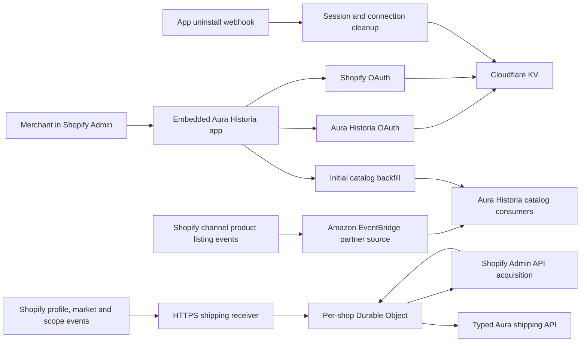

<h1 align="center">Aura Historia for Shopify</h1>

<p align="center">
  A quiet, reliable bridge between Shopify product catalogs and the Aura Historia sales channel.
</p>

<p align="center">
  <a href="https://github.com/aura-historia/shopify-app/actions/workflows/ci.yml"></a>
  <a href="./LICENSE"></a>
  <a href="./package.json"></a>
  <a href="https://shopify.dev/docs/api/usage/versioning"></a>
</p>

<p align="center">
  <a href="#architecture">Architecture</a>&nbsp;&nbsp;·&nbsp;&nbsp;
  <a href="#local-development">Local development</a>&nbsp;&nbsp;·&nbsp;&nbsp;
  <a href="#quality-checks">Quality checks</a>&nbsp;&nbsp;·&nbsp;&nbsp;
  <a href="#deployment">Deployment</a>
</p>

---

## In brief

The **Aura Historia** app is a public, embedded Shopify sales-channel app. It lets approved merchants connect their shops to Aura Historia, makes product discovery possible on Aura Historia, and returns shoppers to the merchant’s Shopify store for checkout.

The app is free to install and use, with no charges or commissions. Shopify has already approved the app. Making it publicly visible in the Shopify App Store is a separate action planned for later.

The app intentionally owns only the integration edge: authentication, merchant connection, initial catalog backfill, session storage, advertised shipping imports, and uninstall cleanup. Amazon EventBridge routing and downstream catalog consumers are maintained separately.

| Shopify | Aura Historia |
| --- | --- |
| Merchant installs from Shopify App Store or Admin | Merchant authorizes Aura Historia from the embedded app |
| Shopify supplies trusted shop context and OAuth approval | Connection metadata is stored in Cloudflare KV |
| Product listing events for the Aura Historia channel are delivered to the configured EventBridge partner source | Products published to the channel are published for discovery |
| Shopper continues to the merchant’s Shopify storefront | No checkout or merchant-of-record responsibility moves to Aura Historia |

## Architecture



### What lives here

- React Router application and embedded Shopify app shell
- Shopify authentication, Aura Historia OAuth, and connection state
- Cloudflare Worker deployment and Cloudflare KV session storage
- Channel-filtered catalog import orchestration in a resumable per-shop Durable Object
- Server-side shipping acquisition, typed mapping and resumable publication
- A per-shop Durable Object coordinating offline Shopify access and shipping jobs
- Shopify sales-channel configuration in `extensions/channel-config` and the explicit channel connection in `app/channel.server.ts`
- Uninstall cleanup at `app/routes/webhooks.app.uninstalled.tsx`

### What does not

- EventBridge infrastructure, rules, or consumers
- A checkout experience or storefront
- Demo pages, sample mutations, or placeholder app logic

## Event delivery

| Topic | Destination | Purpose |
| --- | --- | --- |
| `product_listings/add`, `product_listings/update`, `product_listings/remove` | Aura Historia Amazon EventBridge partner source | Keep products published to the Aura Historia channel current; removal from the channel withdraws them |
| `customers/data_request`, `customers/redact`, `shop/redact` | Aura Historia Amazon EventBridge partner source | Required public-app privacy and compliance handling |
| `profiles/create`, `profiles/update`, `profiles/delete` | This app’s HTTPS `/webhooks/shipping` receiver | Durably schedule current shipping acquisition |
| `markets/create`, `markets/update`, `markets/delete` | This app’s HTTPS `/webhooks/shipping` receiver | Durably schedule current acquisition of [market-driven shipping](#market-driven-shipping) |
| `app/scopes_update` | This app’s HTTPS `/webhooks/shipping` receiver | Recheck current shipping access, import once updated access is approved, and withdraw owned assertions on permission loss |
| `app/uninstalled` | This app’s deployed HTTPS endpoint | Stop shipping, admit owned cleanup, then remove Shopify sessions and connection data |
| `bulk_operations/finish` | This app’s deployed HTTPS endpoint | Admit the channel-filtered catalog export to the resumable catalog importer |

The required public-app compliance subscriptions and product listing subscriptions are declared in `shopify.app.toml` and `shopify.app.prod.toml`.

## Catalog synchronization

Merchants choose which products appear on Aura Historia by publishing them to the Aura Historia sales channel. The channel exists once the merchant connects an Aura Historia account (see [Channel connection](#channel-connection)). That selection governs every catalog path:

- **Ongoing changes** use Shopify's own-channel `product_listings/add`, `product_listings/update` and `product_listings/remove` topics, which Shopify scopes to this app's channel. Publishing adds or restores a product, and edits and stock changes arrive as updates. Removal from the channel withdraws the listing, even if the product stays active elsewhere. Out-of-stock products remain listed with their inventory availability.
- **Initial import, “Import catalog again” and retries** share one bulk export. It resolves the publication of the installation's channel connection and reads `publishedOnPublication(publicationId: …)` for every product. An `ACTIVE` product is upserted only when that membership is explicitly `true`, and withdrawn when it is `false`. A missing value is unknown: the product is reported as a failure and the import is not complete. `DRAFT`/`ARCHIVED` products are withdrawn and other statuses are ignored, as before. Source listing IDs remain Shopify numeric product IDs.
- **Missing access, channel or publication.** Before exporting, the app verifies that `read_product_listings` (or `write_product_listings`) was actually granted to the installation, using a separate `accessScopes` query. It also verifies that the channel connection is bound to the connected listing source and that its publication exists. If any check fails or a read fails, no export runs and the embedded app shows a retryable failure. There is never a fallback to all active products, `onlineStoreUrl`, Online Store publishing or an aggregate count. Every processing step checks the scope, connection and publication again before writing; a rebound connection or changed publication discards the snapshot.

### Channel connection

The app is a channel-config-extension sales channel, so it manages explicit channel connections with `channelCreate`/`channelUpdate` instead of Shopify's legacy install-time channel. `create_legacy_channel_on_app_install` stays `false`: installing the app creates no channel and no publication.

- **Setup.** The connection is created after the merchant authorizes Aura Historia and Aura has accepted the listing source's ingestion configuration with that token, immediately before the initial import. Every “Import catalog again” repeats the same idempotent step, so it also repairs a missing or failed setup.
- **Identity.** One connection per installation with the fixed handle `aura-historia`, the `aura-historia` specification, `accountId` set to the authorized listing source ID and `accountName` “Aura Historia”. The importer only uses a connection bound to the connected listing source.
- **Coverage.** Any store can connect, whatever its market coverage: worldwide, a few countries or a single market. The `aura-historia` specification declares every Shopify country with Aura's languages and sets `expectsOnlineStoreParity = false`. Shopify creates product feeds for the store's region markets that cover a declared country, and binds the connection to the store's defaults when none does. The app never creates, changes or removes markets. With parity required, Shopify refused `channelCreate` unless every declared country had a matching region market, so a store with a single United States market could not connect ([#378](https://github.com/aura-historia/shopify-app/issues/378)). One parity specification per country would need market access and a connection and publication per market country. Parity itself only adds Markets warnings about channel-specific prices, which Aura does not use. Shoppers still check out in the merchant's store (`merchantOfRecord = "merchant"`). The import sends each product's own price in the store currency and reads no product feed, so price or currency settings of a channel market for Aura are not applied. The store currency must still be one Aura supports.
- **Retry, reconnect and concurrency.** A retried callback or import finds the connection by handle and changes nothing. Connecting another listing source rebinds the same connection with `channelUpdate`, so the merchant's product selection is kept. If a concurrent request created the handle first, the existing connection is adopted. No second connection is created.
- **Failure.** A missing `read_product_listings` grant is reported as missing access before any channel write. A Shopify `userErrors` refusal is reported as `CHANNEL_REJECTED`, with Shopify's message in the Worker log, and failed reads as a retryable read failure. The Aura connection and shipping import stay in place; the catalog shows the failure until “Import catalog again” succeeds. A refused or failed setup is never reported as an importable channel.
- **Disconnect and uninstall.** Disconnecting keeps the connection and its product selection for a later reconnect. After uninstall the app can no longer call Shopify. On reinstall, the next connection reuses a surviving connection or creates one.
- **Publication.** `currentAppInstallation.publication` is deprecated in 2026-10 and does not identify an explicit connection; it was empty on the QA installation. The `publications` query requires `read_publications`, which the app does not request. The app therefore reads the app catalogs (`catalogs(type: APP)`, at most 20 pages of 25) and uses the publication of the one catalog that lists its connection. The bulk editor link and membership reads use that publication; the channel count is the connection's `productsCount` for active products.
- **Product feeds.** The specification keeps `productFeedManagement = "automatic"`, so Shopify creates the connection's product feeds. The app subscribes to no `product_feeds/*` topic: catalog sync stays on the publication and the `product_listings/*` topics above.
- **Migration.** Legacy install-time creation was never enabled, so there are no legacy channel records to convert with `channelUpdate`. Installations connected before this release have no channel. Their catalog reports the missing channel, and “Import catalog again” or reconnecting creates it. The Aura OAuth client is unchanged.

### Withdrawals

Imports withdraw only products that are in the Shopify export and known to be ineligible: `DRAFT`/`ARCHIVED` products and `ACTIVE` products not published to the channel, each by its own Shopify product ID. Withdrawing a product that was never imported is a no-op downstream. Aura listings are never read or withdrawn because they are absent from the export.

An import is reported complete only when Shopify reported `COMPLETED` without an error code, the number of product rows equals the operation's `rootObjectCount`, and every membership read was explicit. Otherwise the import is reported as failed with a retry.

### Resumable processing

`bulk_operations/finish` only admits the export to the per-shop `CatalogImporter` Durable Object (`CATALOG_IMPORTER` binding, `catalog-importer-v1` SQLite migration). The webhook returns 503 if admission fails, so Shopify retries. Duplicate deliveries do not restart an admitted import.

Each alarm prepares the export and then submits batches for up to 20 seconds, so a slow download or parse cannot starve submission. It checkpoints after every batch of 100. An evicted or failed step resumes at the next batch, and a batch whose checkpoint was lost is resent with its original idempotency key: `shopify-backfill-<operation>-<put|delete>-<index>`. Failed Shopify reads, including an unreadable publication, are retried with exponential backoff, at most six times, before the import is reported as failed. Only a confirmed missing scope, missing or rebound channel connection, missing publication or replaced publication ends an import immediately.

A newer import can be admitted while an alarm awaits network I/O. Job, alarm and cleanup writes are guarded by the bulk operation that owns the stored job, so an older alarm stops without touching the newer import.

The job stores no credentials. It reads the Aura access token from the backfill context in KV, so disconnect, uninstall or a newer import stops it. “Import catalog again” starts a new export.

### Ordering with live listing events

Bulk writes use the existing canonical asynchronous upsert and withdrawal endpoints without ordering metadata. They have no shared ordering guarantee with listing webhooks:

- An import that overlaps an unpublish can restore the removed product.
- An older withdrawal batch can withdraw a product that was republished later.

“Import catalog again” repairs such a state. Idempotency keys prevent duplicate application only; they do not order bulk writes against webhooks.

### Counts and status

- The channel count is Shopify's `productsCount` of active products published to the channel connection. It is not an import count.
- “Last import” reports the Shopify products checked, the eligible products submitted, the admitted withdrawals of unpublished or inactive products, and failures.
- Acceptance by Aura Historia means queue admission. Search visibility follows asynchronously and still applies product-status rules.
- Missing permissions, a missing or refused channel connection, a missing publication and incomplete exports remain visible as failures with a retry. They are never shown as a successful zero-product import.

### Rollout

There are no active installations yet, so nothing is migrated.

1. Deploy backend listing-event support ([aura-historia/backend#2573](https://github.com/aura-historia/backend/pull/2573)). Do not release this Shopify configuration earlier: without backend routing, live product sync does not work.
2. Deploy the Worker, which adds the `CatalogImporter` migration, and release the Shopify configuration.
3. Verify the following on a development store:
   - A fresh install creates no channel; connecting Aura Historia creates exactly one `aura-historia` connection bound to the listing source, and a retried connection or import creates no second one.
   - The connection is created, without changing any market, on a store with a single region market, on one with several markets in different currencies and languages, and on one with a worldwide market.
   - Products can be selected for the channel, and `product_listings/*` events arrive for that selection.
   - Selected and unselected products.
   - Publication-only removal and restoration.
   - Title, image, price and stock updates.
   - Draft, archive, delete and reactivation.
   - An import that overlaps a publication change, repaired by importing again.

## Local development

### Requirements

- [Node.js](https://nodejs.org/) **22.18 or later**
- A Shopify Partner account and app credentials
- A Cloudflare KV namespace for session storage
- Aura Historia OAuth client ID and secret (confidential client)

### Start the app

```bash
npm ci
npm run dev
```

The default command runs `shopify app dev --use-localhost`.

Create local runtime configuration for the Aura Historia OAuth client. The app requires:

```bash
# PLACEHOLDER: replace with the canonical oc_... ID registered in the stage backend.
AURA_HISTORIA_OAUTH_CLIENT_ID=oc_REPLACE_WITH_STAGE_OAUTH_CLIENT_ID
AURA_HISTORIA_OAUTH_CLIENT_SECRET=
AURA_HISTORIA_OAUTH_ENV=dev
```

Use `.dev.vars` for local Cloudflare binding overrides; shell variables do not override bindings in `wrangler.jsonc`. Production uses the registered client `oc_01m5vyyghjecx8c43drb05hh4n`; its secret is stored as `AURA_HISTORIA_OAUTH_CLIENT_SECRET` in Cloudflare, never in source. Both the client ID and secret are required (`client_secret_post` plus S256 PKCE). The stage and production OAuth clients must each allow `listing-sources:read listing-sources:write product-listings:read product-listings:write` and their respective Shopify callback redirect URI. OAuth refuses to start with a placeholder ID or missing secret. The backend development API base URL is `https://api.stage.aura-historia.com` (production: `https://api.aura-historia.com`). For the Shopify connection, request the Aura Historia OAuth scopes `listing-sources:read listing-sources:write product-listings:read product-listings:write` (separate from the Shopify access scopes below). Set `AURA_HISTORIA_API_BASE_URL` and `AURA_HISTORIA_OAUTH_SCOPE` to match the target backend and registered OAuth client:

```bash
AURA_HISTORIA_API_BASE_URL=https://api.stage.aura-historia.com
AURA_HISTORIA_OAUTH_AUTHORIZE_URL=
AURA_HISTORIA_OAUTH_TOKEN_URL=
AURA_HISTORIA_OAUTH_REDIRECT_URI=
AURA_HISTORIA_OAUTH_SCOPE=listing-sources:read listing-sources:write product-listings:read product-listings:write
```

> **Webhook testing:** Shopify localhost mode cannot call your machine directly. Product and compliance events continue to use EventBridge, while `app/uninstalled` remains pinned to the deployed HTTPS app URL. For direct local testing of the backfill completion webhook, use tunnel mode:
>
> ```bash
> npm run dev:tunnel
> ```

## Shopify configuration

The repository uses separate Shopify configuration files to keep stage-specific EventBridge destinations explicit:

| File | Use |
| --- | --- |
| `shopify.app.toml` | Default local/stage configuration using the development EventBridge partner source |
| `shopify.app.prod.toml` | Production configuration using the production EventBridge partner source |
| `shopify.app.tunnel.toml` | Development tunnel mode; exposes backfill completion and shipping receivers through the active tunnel |

The required Shopify scopes are `read_products`, `read_product_listings`, `read_locales`, `read_shipping` and `read_markets`. `read_product_listings` is required by the channel connection, the own-channel listing topics and the per-publication membership reads. `read_shipping` and `read_markets` must stay required: the profile and market webhook subscriptions are declared statically, and Shopify rejects static subscriptions whose scope is only optional. `read_markets` reads the shipping of [market-driven shops](#market-driven-shipping); the app never writes markets. The same list is mirrored in the `SCOPES` variable of `wrangler.jsonc`. Installation starts from Shopify-owned surfaces, which supply the trusted `shop` and `host` context—merchants are not asked to manually enter a shop domain.

## Advertised shipping imports

Initial Aura connection queues a shipping import independently of the catalog backfill.
The embedded app offers **Import shipping settings** (new acquisition or resume).
Installations approved before `read_shipping` or `read_markets` became required are
asked by Shopify to approve the updated access the next time the app is opened. Until
then shipping status reports the missing permission (`read_markets` only for
market-driven shops) and catalog sync continues; the resulting
`app/scopes_update` notification starts a new acquisition. Existing Aura connections
need reconnection with the additional `listing-sources:read` and `product-listings:read`
OAuth permissions. Register those permissions on both OAuth clients before rollout.

Shipping runs in app-owned Durable Object alarms without an open browser. The
`SHOP_COORDINATOR` binding and `shop-coordinator-v1` SQLite migration are required.
Catalog and shipping use its serialized offline GraphQL path, which delegates token
refresh to the existing Shopify SDK and KV sessions. The backend never calls this
worker, reads its sessions, or receives Shopify credentials.

`app/shipping/acquisition.server.ts`, `mapper.ts`, and `publisher.server.ts` are the
common S01/S02 implementation. Initial connection, **Import shipping settings**,
profile notifications and periodic reconciliation all use that acquisition/mapper/publisher.
Callbacks authenticate the bounded original body with Shopify, require an existing
offline installation and durable source binding, then commit a deduplicated hint
inbox. No provider read, token refresh or Aura publication runs in the callback.
The receiver returns 503 on failed durable admission, so Shopify retries.
Hints carry metadata only and never supply the Aura source identity or policy. Work is ordered by the current shop/source binding and an
increasing durable sequence. Concurrent requests coalesce into a subsequent read.
Conflicts trigger bounded reacquisition; pending uncertain writes retain their body,
request key, sequence and original acquisition time across worker restarts. Missing
catalog listings are retried independently without creating products. Partner-owned
assertions and explicit clears are protected by backend import ownership checks.
Reconciliation resolves other uncertain requests before replacing an acquisition.
An inbox hint received during a scan forces reacquisition before publication.
Already prepared requests resolve with their original keys, sequence and acquiredAt
before newer work; no old observation is rebased onto a current revision.
Publication stops retrying each record after eight failures; acquisition pauses after
eight consecutive failures on a page. Exhausted work remains saved for up to seven days,
subject to replacement by a new complete acquisition during periodic repair. **Import shipping settings**
resumes those exact pending requests before acquiring the latest settings. GraphQL
and Aura API calls have a 20-second timeout, and applied status requires a valid
committed response.

Reads are bounded to 50 records per connection page, 100 profiles or markets, 5,000 products,
4,000 requests and 4 MB of acquisition state. Every page has a persisted checkpoint.
The importer traverses all profile items, assigned variants, product variants, zones
and methods. A final profile/version traversal and product modification checks detect
observed changes and restart affected acquisition; this is not an atomic Shopify
snapshot. Failed/incomplete traversals never retire unseen objects. Only a complete
read can explicitly retire previously mapped, confirmed missing profiles. Complete product comparisons also explicitly remove
previously owned selections/inputs for products that disappeared from Shopify.

The pinned Admin API is **2026-10**. Its published `DeliveryMethodDefinition` schema
exposes `rateProvider` and `methodConditions`. The [shipping option changelog](https://shopify.dev/changelog/posts/new-apis-to-read-and-write-shipping-options-in-delivery-profile)
documents the legacy read expansion of every tier and free condition into separate
methods; all method pages are consumed. A preflight checks the required schema and
granted scope. `read_assigned_shipping` cannot read the complete shop profile/item
membership, so it is insufficient. No shipping write, order, customer or checkout
scope is requested. Any Shopify approval required for `read_shipping` must be
completed in the Partner Dashboard before release; missing access is reported in
shipping status and does not fail catalog sync. Profile webhook subscriptions
belong to this app and use the same shipping read permission. The pinned
[2026-10 WebhookSubscriptionTopic reference](https://shopify.dev/docs/api/admin-graphql/2026-10/enums/WebhookSubscriptionTopic)
lists all three PROFILES topics with `read_shipping` or `read_assigned_shipping`;
full acquisition requires `read_shipping`. No extra scope is needed for
`app/scopes_update`. The pinned webhook examples and backend commit are recorded
in `tests/fixtures/shopify-shipping-webhooks-2026-10.json`.

The supported subset is a profile with one origin group, no unrated origins or
selling-plan applicability, explicit country zones, static rates, minimum
seller-order value conditions and external carrier/app prices. Money is parsed as
decimal strings into exact safe minor units; unsupported currencies/precision stop
publication. All variants must agree before a listing selects one profile. Shopify's
shop-wide profile applies only to variants explicitly marked as requiring shipping;
this flag alone does not establish profile membership or shipping eligibility. Mixed,
incomplete and unsupported membership explicitly suppresses default inheritance.
Profiles with multiple origin groups or selling plans remain unasserted. Province
subsets/rest-of-world zones remain unresolved; weight and upper basket constraints
have no Aura representation and leave the affected service conditional without a
fixed rate. Shopify's cart/profile/location charge groups have no exact Aura charge
basis, so static amounts retain a null basis and a capability notice instead of
claiming a per-item, order or physical-shipment price. Coverage stays partial, and
external prices stay externally calculated.
These rules apply to shops on Shopify's legacy profile model. Shops on
`ShopFeatures.marketDrivenShipping` are read from Markets instead, as described below.
None of these limitations is filled with inferred locations, eligibility, taxes,
packing, duties or checkout prices.

### Market-driven shipping

Shopify moves merchant shipping from delivery profiles into Markets: merchants
opt in from October 1, 2026, and every shop uses the market model by July 1, 2027
([upgrade guide](https://shopify.dev/docs/apps/build/orders-fulfillment/market-driven-shipping/upgrade-your-app)).
For these shops the legacy `deliveryProfile`/`deliveryProfiles` reads can return a
stale snapshot, so the importer never reads them or falls back to them
([#383](https://github.com/aura-historia/shopify-app/issues/383)). Merchants keep their
market settings; returning to legacy profiles is never required.

- **Detection and access.** The preflight reads `shop.features.marketDrivenShipping`.
  `true` selects the Markets read model, which needs `read_markets` (or `write_markets`)
  and the 2026-10 `ShippingConfiguration` fields; `false` keeps the profile importer;
  any other value is an unsupported schema. Missing access is reported as
  `SHIPPING_PERMISSION_REQUIRED` and withdraws owned assertions, as for `read_shipping`.
  The app never calls `marketCreate`/`marketUpdate` or any other mutation.
- **Read surface (Admin API 2026-10).** `markets(sortKey: ID)` reads, 50 per page, each
  market's type, status, condition types, region application level and whether
  `delivery.shipping` is configured and enabled. For active region markets it reads
  `conditions.regionsCondition.regions` (50 per page) and
  `delivery.shipping.optionDefinitions` (5 per page, each with its first rate group and
  up to 25 cart-value tiers). Product and variant traversal is shared with the profile
  importer. Markets have no version, so a second complete read must reproduce the same
  configuration, in any page order, before publication; any difference restarts the
  acquisition. The final verification also re-reads `marketDrivenShipping`, so a shop
  that moves to Markets during a profile read is never published from the deprecated,
  unchanged profiles. Only region markets count toward the 100-market limit. Every
  operation passed 2026-10 schema validation; the sources and the response shapes are in
  `tests/fixtures/shopify-market-shipping-2026-10.json` (values are synthetic).
- **Applicable markets.** Active region markets decide the options of buyers who check
  out from Aura Historia. Company-location (B2B), retail-location (POS) and draft
  markets are not used. Channel markets shape the product feed of a sales channel
  connection; buyers from Aura Historia check out in the online store, where region
  markets apply. Channel markets and markets with combined conditions are therefore
  reported (`MARKET_CONTEXT_UNSUPPORTED`) and not applied, as their prices already are
  not (see [Channel connection](#channel-connection)).
- **Destinations and inheritance.** A destination belongs to the most specific active
  region market containing it. A market without its own shipping inherits from the next
  wider market, following the lineage Shopify infers from strict region subsets; the
  widest one inherits the store default of no shipping. Crossing markets resolve only
  when every path reaches the same shipping; otherwise the destination stays unresolved
  (`MARKET_OVERLAP_UNRESOLVED`). Disabled shipping offers nothing. Shopify subdivision
  codes (such as `CA` in `US`) are not ISO 3166-2 codes, so a country whose parts
  resolve to different shipping, or that is only partly covered, is only an unresolved
  area. A market for all regions becomes an unresolved rest-of-world area plus the
  countries that inherit from it.
- **Options.** Each active option becomes a service whose code derives from its Shopify
  ID. Its rates are representable only from one rate group without collection or
  origin-location conditions, the only group that rates every shippable item alike.
  Shopify's create input sets conditions only when given, so an origin location count
  of zero is read as no location condition; the [release checklist](#release-checklist)
  confirms this on a market-driven store. Conditioned, multi-group or rate-less options and more than 25
  cart-value tiers stay conditional without a rate (`MARKET_RATE_CONDITIONS_UNSUPPORTED`,
  `MARKET_RATE_TIER_LIMIT`). Otherwise the profile importer's semantics apply: flat rates
  are fixed or free amounts; a cart-value tier with only a lower bound is a threshold,
  while upper bounds and weight-based rates stay conditional; carrier-calculated
  options are calculated at checkout. A free-delivery minimum makes the whole option
  free from that cart subtotal: it adds a free service with a seller-order threshold
  where the option is certainly available (a flat rate, or a cart-value tier open from
  the minimum), and leaves paid prices conditional because they apply only below it.
  Currencies and minor units are exact; an option whose currency or precision Aura
  cannot represent stays conditional (`MARKET_CURRENCY_UNSUPPORTED`) without affecting
  other options. Transit time in whole days or hours becomes the transit lead time
  without a business or calendar basis; other durations stay unasserted. Rate consolidation and split shipping decide the combined checkout
  charge, so amounts keep a null basis with `SHOPIFY_CHARGE_GROUP_BASIS_UNAVAILABLE`.
- **Applicability.** The market configuration is one profile, `shopify:market-shipping`,
  assigned as the source default. Market rates apply to items that require shipping, so
  the rules of a shop-wide profile apply: a product whose variants all require shipping
  selects it explicitly, and mixed or unknown products suppress inheritance. Rates that
  other apps' delivery profiles add in Markets are not read
  (`APP_PROVIDED_RATES_UNASSERTED`).
- **Model switches.** Only a complete acquisition of the current model is published.
  Moving to market-driven shipping retires the imported profile identities; a rollback
  retires the market profile and restores them. Once the preflight finds market-driven
  shipping, terms imported from profiles are known to be stale: if the market import is
  blocked before its profile is published, they are withdrawn like on permission loss
  instead of staying current.
- **Notifications.** `markets/create`, `markets/update` and `markets/delete` are refresh
  hints like profile notifications; their payload carries only the numeric market ID.
  Shopify does not document which shipping option edits update a market, and collection
  or location changes send no shipping notification, so reconciliation within six hours
  guarantees convergence and **Import shipping settings** refreshes at once.
- **Alternatives.** Shopify recommends Contextual Product Feeds for sales channels. Their
  per-variant delivery option estimates are contextualized checkout estimates, not the
  merchant's options and conditions, and this app reads no product feed.
- **Verification.** Tests cover initial import, rate and threshold edits, option and
  market removal, multiple and nested markets, subdivisions, free-delivery minimums,
  currencies, missing access, unsupported fields, retries, model switches (including a
  blocked switch) and read-only Shopify access against the 2026-10 shapes. Live
  verification and Shopify's compatibility status are tracked in
  [Market-driven shipping compatibility](#market-driven-shipping-compatibility).

Status distinguishes queued work, acquisition, publication, partial progress,
protected partner edits and applied operations. Applied means Aura committed the
typed write; discovery indexing remains eventual and no shipping quote is promised.
Use the authenticated **Import shipping settings** action to repair after resolving
permissions, capabilities or a bounded failure. **Refresh shipping status** distinguishes
committed operations from pending work; search indexing remains eventual.

The official generated Aura client is pinned in `openapi-ts.config.ts` to backend
commit `597425dcca064e7128072b988042ab3f9b1aedd1` (the production `/v1` contract).
Run `npm run openapi:generate` to reproduce it; review later contract changes
explicitly. Backend URLs use `/v1`, including `/v1/oauth/token` and `/v1/oauth/revoke`; the former `/api/v1` routes have no compatibility aliases. Browser consent starts at `/en/oauth/authorize`. Catalog and shipping imports share the current currency registry, including ARS and zero-decimal JPY/KRW. `tests/fixtures/shipping-contract.json` is the executable contract
fixture from that contract (its command examples remain unchanged). Ordinary typed shipping writes carry `import` metadata
with `observation: {}` for successful acquisitions, and no expiry/freshness fields.
Protected shipping evidence is excluded from management responses. The strict import/write contract remains separate from the public shipping read projection.

### Market-driven shipping compatibility

Shopify shows merchants whether an app supports market-driven shipping. Until an app
is confirmed compatible, installing it warns that the app uses the legacy shipping
configuration, and **Settings → Apps** and **Sales channels** say that the app is not
compatible with market-driven shipping. Shopify also does not move the app's merchants
to market-driven shipping automatically
([#393](https://github.com/aura-historia/shopify-app/issues/393)). Shopify tries to
detect compatibility itself, but for this app the warning remained after the market
reader shipped. The way to confirm it is Shopify's
[compatibility self-attestation](https://shopify.dev/docs/apps/build/orders-fulfillment/market-driven-shipping/upgrade-your-app#confirm-compatibility):
a form that the app owner submits once the integration is upgraded and verified. It is
not a setting in `shopify.app.toml` and no deployment submits it.

**Integration.** The app reads merchant shipping and follows reader option B of the
upgrade guide: shops with `marketDrivenShipping` are read from `Market.delivery` with
`read_markets`, and only shops without it are read from `deliveryProfiles`. The app
owns no delivery profiles, writes no shipping or market settings and requests no
`write_shipping` or `write_markets` scope. `tests/market-shipping-compatibility.test.ts`
is the audit the guide asks for. A market-driven acquisition sends no merchant delivery
profile operation, and legacy shops are still read from their profiles. Profile reads
are confined to the legacy acquisition, and no source writes delivery profiles or
markets.

**Supported subset.** Each market setting is imported, left conditional without a
fixed rate, left unresolved, or not used. Nothing is guessed, and shipping status
names the notice. Merchants never need to change their markets or return to legacy
profiles.

| Market setting | Behavior | Notice |
| --- | --- | --- |
| Countries of active region markets | Imported, inheriting from wider markets | — |
| Subdivisions, or a country split across markets | Unresolved area | `SUBDIVISION_MAPPING_UNAVAILABLE` |
| Market for all regions | Unresolved rest of world, plus the countries that inherit from it | `REST_OF_WORLD_UNRESOLVED` |
| Crossing markets with different shipping | Unresolved | `MARKET_OVERLAP_UNRESOLVED` |
| Flat rates and cart-value tiers with only a lower bound | Imported as fixed or free amounts and seller-order thresholds | — |
| Free-delivery minimum | Free from the minimum where the option certainly applies; paid prices below it conditional | `UNSUPPORTED_RATE_CONDITION` |
| Upper cart-value bounds, weight-based rates | Conditional | `UNSUPPORTED_RATE_CONDITION` |
| More than 25 cart-value tiers | Conditional | `MARKET_RATE_TIER_LIMIT` |
| Carrier-calculated options | Calculated at checkout | `EXTERNAL_RATES_REQUIRE_CHECKOUT` |
| Option currency or precision Aura cannot represent | That option conditional | `MARKET_CURRENCY_UNSUPPORTED` |
| Combined checkout charge | Amounts keep a null basis | `SHOPIFY_CHARGE_GROUP_BASIS_UNAVAILABLE` |
| **Product:** rate groups limited to collections | Conditional | `MARKET_RATE_CONDITIONS_UNSUPPORTED` |
| **Product:** variants that all require shipping | Product selects the market profile | — |
| **Product:** mixed or unknown variants | No profile and no inherited default | `MIXED_OR_UNKNOWN_MEMBERSHIP` |
| **Location:** rate groups limited to origin locations | Conditional | `MARKET_RATE_CONDITIONS_UNSUPPORTED` |
| **Location:** retail-location (POS) markets | Not used | — |
| **Customer:** company-location (B2B) markets | Not used | — |
| **Channel:** channel markets and combined conditions | Reported, not applied | `MARKET_CONTEXT_UNSUPPORTED` |
| Draft markets and inactive options | Not used | — |
| Rates from other apps' delivery profiles | Not read | `APP_PROVIDED_RATES_UNASSERTED` |

**Verification.** On 2026-10-29, release 0.3.3 (source `fd28f93`, Admin API 2026-10)
ran on a development store with `marketDrivenShipping` and one United States region
market. The app acquired the market and imported the market profile, the source
default and product memberships. It refreshed them after a shipping option was
created and edited. Options with origin-location conditions stayed conditional with
`MARKET_RATE_CONDITIONS_UNSUPPORTED`. The store was never switched back to legacy
shipping. Without an attestation, Shopify still showed its warning at install and on
the installed settings page.

**Assessment.** Ready to attest. Shopify asks for an upgraded and verified
integration. For market-driven shops the app reads only Markets, never the stale
profile snapshot, and writes nothing. The supported subset is a product limit, not a
compatibility gap: unsupported settings stay unasserted instead of being advertised
wrongly.

**Status.** As of 2026-10-29: **not attested**. Shopify still shows the warning. Update
this line with the date and release whenever the attestation is submitted or
Shopify's status changes.

**Attesting.**

1. Complete the [release checklist](#release-checklist) for the release to attest.
2. The app owner submits the form linked from Shopify's guide.
3. Once Shopify confirms, check a fresh install and the installed settings page on a
   market-driven store. The warning must be gone. Record the result in **Status**.
4. Never switch a store back to legacy shipping, or ask a merchant to, to hide the
   warning.

### Continuous refresh and recovery

`app/routes/webhooks.shipping.tsx` is the app-owned receiver. Stage/default and
production declare absolute `https://partner-connect.aura-historia.com/webhooks/shipping`
destinations; localhost development therefore uses the deployed receiver. Tunnel
configuration declares `/webhooks/shipping`, resolved to the active HTTPS tunnel.
The product/compliance EventBridge destinations and uninstall/bulk endpoints retain
their existing destinations. No additional product notification or catalog mutation
is submitted by shipping. A Worker deployment does not activate a new Shopify configuration version. Shopify configuration is released separately with a semver tag; live merchant exports are initiated only by the authorized installation.

The per-shop Durable Object has a transactional hint inbox independent of provider
I/O. It retains up to 512 delivery receipts per source/connection for 48 hours,
returning retryable backpressure at capacity. Delivery IDs deduplicate within that
binding; a reconnect creates a new random connection generation. Callback bodies
are limited to 16 KiB. Topics, API version and profile GIDs are validated. A delete
is a refresh hint: a complete API traversal and final verification must confirm
absence before retiring a previously owned profile. Scope errors, missing pages
and failed reads preserve prior terms and observation age. Scope-change notifications
fence old prepared writes before the next current-access check.

Every bound shop schedules a new reconciliation six hours after successful work.
Paused work gets a bounded new acquisition at that interval; each run retains the
S01 limits (100 profiles, 5,000 products, 4,000 pages, 4 MB). This covers profile
assignment changes, product/variant membership and requires-shipping changes,
origin-group/configuration changes and missed notifications independently of catalog
EventBridge processing. It does not assume that profiles/update observes every
assignment change. Market-driven shops get the same periodic read of their markets,
regions and options. Unsupported origin or market configurations remain
unasserted and actionable. This is acquisition of current state, never TTL renewal
or a scan of backend CDC/SQS pending work. Existing installations enter this schedule
on their next initial/manual import; there is no unbounded installation enumeration.

Worker alarms checkpoint one provider request or typed prepare/send step at a time.
Eight attempts per record/page and exponential delays bound automatic retries.
Missing catalog listings remain deferred with SHIPPING_IMPORT_DEPENDENCY_MISSING,
whether the backend reports that code or an assignment lookup returns the documented
404 PRODUCT_LISTING_NOT_FOUND; other 404s keep their HTTP category. Manual repair
resumes exact pending requests, and the seven-day retention cap bounds old request
bodies. A new complete acquisition may supersede exhausted
work, using stable object identities and a new acquisition order. The callback
inbox does not wait for provider reads and cannot overwrite a connection stop.

Permission loss withdraws owned shipping profiles, defaults, listing selections
and inputs through the existing typed commands. Selection and input removals are
independent; manual edits/clears and collection/shipping overrides stay protected
by backend ownership checks. Product synchronization credentials remain usable.
Uninstall/disconnect queues the same removals, then attempts Aura OAuth token
revocation. OAuth revocation is recorded separately; it is not reported as source
or grant revocation. A reconnect leaves the current connection running until the new
grant has configured the provider and its record is stored. The previous binding's stop,
cleanup and token revocation then commit with the new binding in one serialized step; a
failed attempt revokes only the new grant. Source switching therefore fences old work
and queues cleanup before new acquisition; at most five connection cleanups can be
retained. Removals retain
the last successful source acquisition time, so a newer backend authority boundary
is never bypassed with a new timestamp. Reconnect always reads Shopify again.

Cleanup status distinguishes **pending**, **committed** owned removals, and
**unconfirmed** cleanup. Configuration/authority conflicts, unavailable credentials
or exhausted retries can leave cleanup unconfirmed; it is visible in the embedded
app where the installation is still accessible. Reconnect and import current
settings, or have an authorized source administrator remove the remaining imports
and review source/grant configuration. Stopping locally, erasing sessions or revoking
an OAuth token does not prove that backend assertions were removed. Unconfirmed
assertions can remain available beyond 30 days until explicitly updated/withdrawn
or a backend source/configuration/grant authority change commits. They never expire
because of observation age. Discovery indexing follows existing backend CDC/SQS
continuations and retry/DLQ controls.

### External services and privacy

With the merchant's installation approval, Shopify provides shipping profile
names/IDs, location-group identities, destination areas, advertised
methods/conditions/prices and complete
product/variant membership; for market-driven shops it provides market types,
regions and shipping options/rates instead of profiles. Cloudflare stores bounded private job checkpoints,
resource mappings and immutable pending typed requests. Aura Historia receives only
the canonical terms, source-scoped membership and acquisition metadata through its
authorized API. Shipping requests contain no provider domain, token, session, raw
provider payload, customer data or precise fulfillment address. The separate catalog
ingestion domain configuration remains necessary for existing EventBridge ingestion.
Errors exposed by shipping status contain categories, never provider response bodies
or credentials. Disconnect durably fences publication before admitting cleanup; uninstall also
erases Shopify sessions and the ordinary Aura connection immediately. Only required
Aura credentials for cleanup remain in a separate protected KV entry, with a
seven-day maximum retention. No Shopify token is copied. Cleanup state retains only
canonical typed removal requests and resource identities, then discards them.
Minimal stop/status tombstones are erased after seven days; unknown installations
and hints cannot recreate a binding. A stopped connection record that is still stored
keeps only its stop tombstone until a disconnect, uninstall or new authorization
replaces it; the embedded app reports it as stopped and offers only a new
authorization, never a retry with that record.
The linked Aura privacy policy and App Store access disclosure must reflect this
processing when the feature is released.

## Quality checks

Run the full suite before opening a pull request:

```bash
npm run lint
npm run typecheck
npm run test
npm run build
```

| Command | Responsibility |
| --- | --- |
| `npm run lint` | Biome formatting and lint checks |
| `npm run typecheck` | React Router type generation and TypeScript validation |
| `npm run test` | Focused Node test suite |
| `npm run build` | Production React Router build |

GitHub Actions runs these checks across Node.js 22.18, 24.15, and 26.1 on pushes and pull requests. See [`.github/workflows/ci.yml`](./.github/workflows/ci.yml).

## Deployment

- `npm run lint`
- `npm run typecheck`
- `npm run test`
- `npm run build`

```bash
npm run cf-deploy       # Build and deploy the Cloudflare Worker
npm run config:use:prod # Select Shopify production configuration locally
npm run deploy:prod     # Deploy Shopify app configuration to production
```

The GitHub Actions workflow requires these repository secrets:

- `CLOUDFLARE_API_TOKEN`
- `CLOUDFLARE_ACCOUNT_ID`
- `SHOPIFY_APP_AUTOMATION_TOKEN`

See [`.github/workflows/deploy.yml`](./.github/workflows/deploy.yml) for the release definition. A manual workflow dispatch runs the same checks and deploys only the Worker. A semver tag also releases the production Shopify app configuration. Production URL rewriting by Shopify development commands is disabled.

### Release checklist

Complete this list before pushing a semver tag and record the outcome in the release
pull request. It keeps the implementation and what Shopify shows merchants aligned.

1. **Checks.** Lint, typecheck, test and build pass in CI on the commit to tag.
2. **Market-driven shipping.** Use a development store with market-driven shipping and
   at least one active region market:
   - Install the release, connect Aura Historia and run **Import shipping settings**.
     Shipping status reaches *Applied* or *Partially applied*, with only notices from
     the [supported subset](#market-driven-shipping-compatibility).
   - Create a shipping option without collection or location restrictions, import, then
     edit its rate and import again. Each import advertises the option's current fixed rate.
     This confirms that an origin location count of zero means no location condition.
     If the option stays conditional with `MARKET_RATE_CONDITIONS_UNSUPPORTED`, update
     the supported subset before tagging.
   - Remove the test option and restore the store's settings. Never switch the store
     back to legacy shipping.
3. **Legacy shipping.** On a store without market-driven shipping, the profile import
   still applies as before.
4. **Shopify compatibility status.** Check the install consent of a fresh install and
   **Settings → Apps** and **Sales channels** on a market-driven store. Compare them with
   the [recorded status](#market-driven-shipping-compatibility) and update it. A
   release that changes the shipping read model or the supported subset repeats the
   verification first. If Shopify still warns after the attestation, contact Shopify
   Partner Support instead of changing store settings.
5. **Disclosures.** The privacy policy and App Store access disclosure match
   [External services and privacy](#external-services-and-privacy).

The Worker keeps OAuth/authenticated responses private and uncached, uses `Referrer-Policy: no-referrer`, and redacts query strings from Cloudflare invocation logs. Catalog progress stores only phase/counts for seven days and is cleared on disconnect/uninstall; access tokens remain only in the separate existing credential stores. Channel counts come from the current Shopify channel connection and retain the API's lower-bound indicator. The bulk editor link targets that connection's publication. Import acceptance is distinct from search visibility.

## Production OAuth

The production Aura Historia client ID is `oc_01m5vyyghjecx8c43drb05hh4n`. Its registered callback is exactly `https://partner-connect.aura-historia.com/oauth/callback`, and its four scopes are configured in `wrangler.jsonc`. The client secret is installed in the production Worker's `AURA_HISTORIA_OAUTH_CLIENT_SECRET` secret binding.

The webapp consent flow supports `/v1`, S256 PKCE, registered callback validation, and `listing_source_id`. Use a current webapp version; older checkouts using `/api/v1` and partner-shop IDs are incompatible with the production backend.

## Public app information

- Website: [aura-historia.com](https://aura-historia.com)
- Privacy: [aura-historia.com/privacy](https://aura-historia.com/privacy)
- Terms: [aura-historia.com/terms-and-conditions](https://aura-historia.com/terms-and-conditions)
- Imprint: [aura-historia.com/imprint](https://aura-historia.com/imprint)
- Support: [contact@aura-historia.com](mailto:contact@aura-historia.com)

## License

Distributed under the [MIT License](./LICENSE). Copyright © 2026 Aura Historia.

---

<p align="center">
  
</p>
